<!--
PALETA (psicologia del color):
  #05040d  Tinta negra     -> misterio, intensidad, "nivel serio"
  #3b82f6  Azul energia    -> confianza, logica, concentracion
  #7c3aed  Violeta         -> ambicion, poder, mente creativa
  #e11d48  Rojo tajo       -> peligro, pasion, impacto (se usa poco = pega mas)
  #22c55e  Verde Pupil     -> crecimiento (color oficial del rango en Codeforces)
  #fbbf24  Dorado          -> logro y recompensa

ARCHIVOS (todos en la raiz del repo Hecrry/Hecrry):
  README.md, header.svg, stats.svg
  assets/cf-card.svg                       <- se actualiza sola
  .github/scripts/cf_card.py
  .github/workflows/codeforces-card.yml

PARA QUE EL RANGO SE ACTUALICE SOLO:
  Repo > Settings > Actions > General > Workflow permissions > "Read and write permissions" > Save
  Luego Actions > "Actualizar tarjeta de Codeforces" > Run workflow (la primera vez).

TU PROPIO ARTE: guarda tus imagenes en assets/ y descomenta el bloque "Galeria" mas abajo.
-->

  

---

## 🩸 Hoja de hechicero

  

---

## ⚡ Rango en vivo

  

> Esta tarjeta se sincroniza con Codeforces cada 6 horas. Cuando suba de rango, cambia sola.

### Escala de grados

| Grado | Rango en Codeforces | Estado |
|:---:|:---|:---:|
| 🩶 Grado 4 | Newbie | ✅ Superado |
| 🟢 **Grado 3** | **Pupil** | 📍 **Aqui estoy** |
| 🩵 Grado 2 | Specialist | 🔥 Siguiente objetivo |
| 🔵 Grado 1 | Expert | 🔒 Pendiente |
| 🟣 Grado Especial | Candidate Master o mas | 🔒 Pendiente |

---

## 🗡️ Tecnicas

  

---

## 📜 Misiones

| | Mision | Recompensa | Estado |
|---|---|---|---|
| ⚔️ | **Notebook del equipo** | Todo el arsenal de algoritmos listo para competir, en LaTeX | ✅ Completada |
| 📖 | **Docs de Prog. Competitiva** | Teoria + codigo + ejemplos por tema, empezando por geometria | 🔥 En curso |
| 🧪 | **MisMetodosNumericos** | Libreria propia de metodos numericos para Colab | ✅ Completada |
| 🌐 | **Rediseño web UniAmazonia** | Pagina de Ingenieria de Sistemas moderna y responsiva | ✅ Completada |
| 🏆 | **Newbie ➜ Pupil** | Primer ascenso en Codeforces | ✅ Completada |
| 👑 | **Pupil ➜ Specialist** | Siguiente jefe | 🔥 En curso |

---

## 🏅 Logros

- 🟢 **Primer ascenso**: de Newbie a Pupil en Codeforces
- 📚 **Escriba**: documento lo que aprendo para que otros no empiecen de cero
- 🎓 **Sensei**: tutor de matematicas y fisica
- 🧩 **Forjador de herramientas**: libreria propia + notebook del equipo

---

## 🔥 Constancia

  

<!--
## 🖼️ Galeria  (descomenta cuando tengas tus imagenes en assets/)

  

-->

---

## 🤝 Unete a mi equipo

Estetica inspirada en el anime. Proyecto de fan, sin afiliacion. Diseño original.

